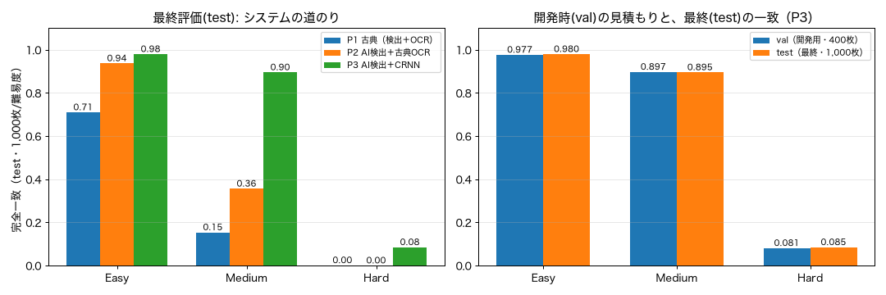
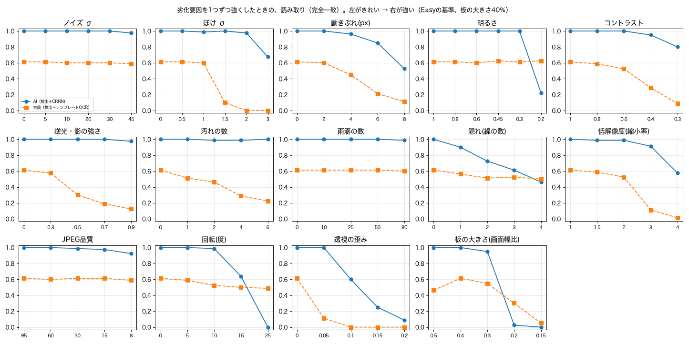
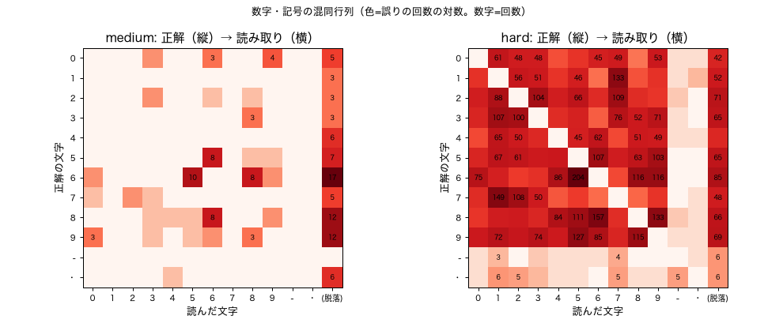
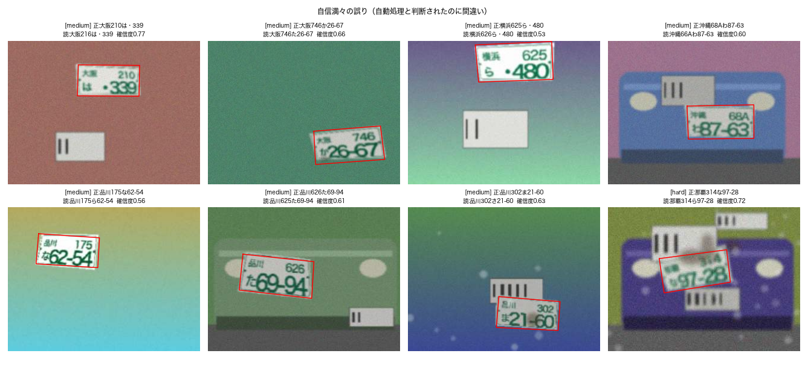

# REPORT.md — 最終レポート

ナンバー風の**合成画像**を読み取る駐車場精算ミニシステムを、検出・文字認識・書式検査・確信度・入出庫照合まで**1つのシステムとして**作り、検証した記録。
目的は高精度ではなく、**「AIはシステムの一部品」であることを、自分の手で確かめる**こと。

> 🔒 実在のナンバーや実際の車の写真は使っていない（すべて合成）。数字は**設計の考え方を学ぶためのもの**で、実運用の精度ではない。

## 1. システム構成

```
合成画像 ─▶ ①検出(四隅を回帰: ResNet18) ─▶ ②OCR(CRNN+CTC) ─▶ ③書式検査 ─▶ ④確信度(seq)で振り分け
   ─▶ 自動処理 ／ 要確認(候補つきで人へ) ／ 読み取り不可(人が手で)
   ─▶ ⑤入出庫(SQLite): 入庫を記録 → 出庫で照合 → 料金計算 ─▶ ⑥評価・検証
```

| Phase | 内容 | ドキュメント |
|---|---|---|
| 0 | 合成データ生成器（難易度3段階・正解自動付与・固定シード評価セット） | [DATA_SPEC.md](DATA_SPEC.md)、[notebooks/00](notebooks/00_synth_data.ipynb) |
| 1 | 非AIのベースライン（古典的な検出＋テンプレートOCR） | [notebooks/01](notebooks/01_classical_baseline.ipynb) |
| 2 | 学習する検出器（四隅回帰。小CNN／ResNet18転移学習） | [notebooks/02](notebooks/02_detection_cnn.ipynb) |
| 3 | 学習する文字認識（CRNN＋CTC） | [notebooks/03](notebooks/03_ocr_crnn.ipynb) |
| 4 | 書式検査・確信度・「自動処理／要確認／読み取り不可」 | [notebooks/04](notebooks/04_rules_confidence.ipynb) |
| 5 | 入出庫シミュレーション（誤課金・人手の測定） | [notebooks/05](notebooks/05_parking_system.ipynb) |
| 6 | 評価・検証レポート、最終評価（test・1回だけ） | [notebooks/06](notebooks/06_final_report.ipynb) |
| 7（発展） | 学習なしのAI（VLM）との比較（作るか借りるか） | [notebooks/07](notebooks/07_vlm_comparison.ipynb) |

詳細な設計・実験メモは [MANUAL.md](MANUAL.md)、計画と進捗は [PLAN.md](PLAN.md)、評価指標は [EVALUATION.md](EVALUATION.md)。

## 2. 最終評価（test。1回だけ使用）

評価データ: test（難易度ごとに1,000枚、計3,000枚）。モデルとしきい値は評価の前に固定（記録: `outputs/final/TEST_USED.json`）。CRNNは3シードの平均。

### システムの道のり（完全一致）

| 難易度 | P1 古典（検出＋OCR） | P2 AI検出＋古典OCR | **P3 AI検出＋CRNN** | （参考）CRNN・正解の四隅 |
|---|---|---|---|---|
| Easy | 0.710 | 0.937 | **0.980** | 0.981 |
| Medium | 0.154 | 0.356 | **0.895** | 0.940 |
| Hard | 0.001 | 0.000 | **0.085** | 0.209 |



- **開発時（val）の見積もりと、最終（test）が±0.01以内で一致**（P3）。開発中の評価が未使用データでも信頼できた。
- Hard は、AIでもほとんど読めない（画像から情報が失われている）。

### 検出

| 難易度 | 検出率(IoU≥0.5) | Det@0.9 | 四隅誤差(px) | 古典の検出率 |
|---|---|---|---|---|
| Easy | 1.000 | 0.998 | 1.56 | 0.905 |
| Medium | 1.000 | 0.824 | 2.86 | 0.760 |
| Hard | 0.998 | 0.196 | 5.06 | 0.402 |

### 振り分け（P4。自動処理のしきい値は較正セットで決定。目標の誤り率1%・昼間中心）

| 難易度の混ぜ方 | 自動処理率 | 自動処理の誤り率 | 要確認率 | 読み取り不可率 | 人手対応率 |
|---|---|---|---|---|---|
| **昼間中心**（Easy 0.6／Medium 0.3／Hard 0.1） | 0.795 | **0.88%** ±0.22% | 0.165 | 0.040 | 0.205 |
| 均等（1:1:1） | 0.580 | 1.38% ±0.49% | 0.321 | 0.099 | 0.420 |

- 昼間中心の想定では、誤り率は**見積もりどおり（目標1%）**。想定と違う混ざり方（均等）では、**ずれる**。
- 難易度別: Easy は自動処理92%・誤り0.19%、Medium は79%・2.3%、Hard は自動処理2%（ほぼ全部を人へ）。

### システム全体（Phase5、入出庫シミュレーション。各12,000台の出庫）

- AIの「自信満々の読み誤り」（自動処理で間違い）は約0.6%（S2: 10,208件中57件）。システムの**誤課金は12,000件中1件**。**DB照合が、AIの誤りの大部分を止める**。
- 近傍チェック（1文字違いの別の記録があれば要確認）は誤課金を0にするが、**人手が2〜4倍**。誤課金が要確認の約72倍以上の損害ならP1、約2,700倍以上なら近傍チェックが得（**方針は損害の重さで決まる**）。
- 人手の約6割は Hard（撮影条件が悪い）。

### 学習なしのAI（VLM）との比較（Phase7。新しい未使用セット test2・各難易度60枚の共通画像）

| システム | Easy | Medium | Hard | 速度 | 画像の外部送信 |
|---|---|---|---|---|---|
| **自作**（検出＋CRNN＋検査・確信度） | 0.983 | 0.928 | **0.072** | 約0.06秒 | なし |
| ローカルVLM（qwen3.8:27b・書式つき） | 1.000 | 0.917 | 0.000 | 約3.9秒 | なし |
| Claude Sonnet（書式つき） | 1.000 | 0.950 | 0.000 | 約11秒 | あり（合成画像のみ） |
| Claude Haiku（書式つき） | 1.000 | **0.383** | 0.000 | 約18秒 | あり（合成画像のみ） |

- **学習なしのVLMも、書式を教えれば、Easy・Mediumで自作に並ぶ**（大きめのモデル。信頼区間が重なる）。小さなモデル（Haiku）はMediumで大きく劣る。**Hardは自作が有意に上**（ローカルVLM100枚: 自作 約0.11 vs 0.00）。
- **書式（課題の知識）を教えると、+9〜17pt**。プロンプトの工夫は、自作の学習・書式ルールと本質的に同じ（知識を渡す作業）。
- **VLMは「分からない」と言える**（Hardで自己申告の自信0.1〜0.3）。ただし標本が小さく、較正は未検証。
- **併用**（自作が自動処理に回さないものだけVLMに聞く）で、昼間中心の自動処理率 0.79→0.87（誤り率は悪化せず。探索的）。
- **使い分け**: まずVLMで試す（数時間でベースライン）。速度・コスト・プライバシーが重要な本番は自作。**作る価値は、精度だけでなく、速度・コスト・プライバシー・制御にある。**

## 3. 主要な発見

### AIについて
1. AIは条件がそろえば強い（Medium: 古典0.15 → AI 0.90）。ノイズ・汚れ・逆光・雨滴・JPEG劣化に強い。
2. **学習した範囲の外では、急に崩れる**（板の大きさ・回転・透視）。学習データの条件の設計が、AIの得意・不得意を決める（合成データの利点は、条件を自由に設計できること）。古典のほうが強い条件（回転、小さな板）もある。
3. AIは「分からない」と言えない。板が無くても答える。確信度（seq）は粗い手がかりにとどまる。
4. 画像に情報が無いもの（Hard）は、AIにも読めない。

### システムについて
5. **AIはシステムの一部品。** 検査・確信度・DB照合・料金・人の確認が、AIの弱点を補う。
6. 書式検査は安全で有効（弾いたものは100%誤り）。**補正は効果ほぼゼロ**（もっともらしい嘘を作る）。
7. DB照合が、AIの自信満々の誤りの大部分を止める。誤課金が起きるのは、似たナンバーの車が同時にいて、AIがそっくりに読み間違えたとき。起きると二次被害（別の車の記録が誤って閉じられる）を生む。
8. 人手を減らす最大の手段は、AIの改良より、**撮影条件の改善**（カメラ・照明・設置）。

### 評価について
9. システム全体で測らないと、本当の性能は分からない（検出率100%でも、四隅誤差が大きいと読めない）。
10. しきい値は、評価とは別の十分な数のデータ（較正セット。300枚では足りず、3,000枚）で決める。
11. **最終評価は1回だけ。** 使用済みの記録で、2回目を拒否する。
12. 失敗にも記録を残す（評価セットを誤って壊した事故、pandasの`gt`の集計バグ、CTCの出力位置の説明の誤り）。
13. **「作るか、借りるか」は、精度だけでは決まらない。** 学習なしのVLMは、課題の知識を教えれば、Easy・Mediumで並んだ。差が出るのは、Hard・速度・コスト・プライバシー・制御。

## 4. 運用できる範囲（劣化要因の単独アブレーション。AIの完全一致が0.9以上を保つ強さ）



| 項目 | 目安 |
|---|---|
| 板の大きさ | 画面幅の30%以上 |
| 回転 | 10度以内 |
| 透視の歪み | 0.05以内（正面から撮る） |
| ぼけ | σ2以内 |
| 動きぶれ | 4px以内 |
| 明るさ・コントラスト | 明るさ0.3以上、コントラスト0.4以上 |
| 隠れ | 線1本まで |
| ノイズ・汚れ・雨滴・JPEG圧縮 | ほぼ問題なし |

## 5. 取り違えと失敗例



- Medium: 取り違えは少なく、形の似た数字（6↔5、6↔8）とかな（な↔は、ま↔あ、た↔か）、脱落が中心。
- Hard: ほぼ全部の数字が互いに取り違えられる（7↔1、6↔5、8↔6、9↔5）。ぼけ・ノイズ・低解像度で、細部が失われるため。



- 自信満々の誤りは、ほぼ全部が**1文字だけの取り違え**（210→216、か→た、な→ら）。書式に合うので検査で防げず、確信度も中程度。→ DB照合が止める。

## 6. 限界と注意

- **合成画像だけ。** 書体・背景・質感は実物と違う（sim2realギャップ）。実画像では、運用できる範囲はもっと狭い。
- ナンバーの書式は簡略化（地名5種、かな10種など）。
- 人の確認は常に正しいと仮定。ゲートの渋滞・確認の待ち時間・夜間の無人運用は未検討。
- 検出器は1つ（ResNet18、シード0）、CRNNは3シード。誤課金の件数は少なく、方針間の差は傾向として読む。
- 実運用では、ナンバーは所有者につながる情報（取得目的・保存期間の限定が必要）。

## 7. 再現手順

```bash
python3 -m venv .venv && .venv/bin/pip install -r requirements.txt
.venv/bin/python src/make_eval_sets.py && .venv/bin/python src/make_eval_sets.py --val 0 --test 0 --cal 1000   # 評価セット・較正セット
bash src/run_phase2.sh      # 検出器の学習（約50分）
bash src/run_phase3.sh      # OCRの学習（約60分）
.venv/bin/python src/eval_phase4.py      # 書式検査・確信度・振り分け
.venv/bin/python src/run_phase5.py       # 入出庫シミュレーション（約15分）
.venv/bin/python src/eval_report.py      # 検証レポート（val。約7分）
.venv/bin/python src/final_eval.py       # 最終評価の予行演習（val）。testは --split test --confirm-final（1回だけ）
.venv/bin/python src/run_phase7.py ask --split test2 --n 60 --models ollama:qwen3.8:27b-mlx --prompts format   # VLM比較（合成画像のみ）→ report で集計
.venv/bin/python -m unittest discover -s tests    # テスト74件
```

※ `data/`・`outputs/`（生成画像・学習済みモデル・評価結果）はgit管理外。コードとシードで再現できる。使用済みのtestの記録（`outputs/final/TEST_USED.json`）は、手元の環境にある。

## 8. 今後

- 実画像での検証（プライバシーに配慮した手順が前提。外部サービスへの送信は不可。sim2realギャップの確認）。
- 検出の改良（torchvisionの検出モデル）、ヒートマップによる四隅の精密化。
- 併用の本格的な検証（別のデータで、しきい値も含めて）、VLMの確信度の較正の確認、他のVLM・プロンプトの比較。
- この考え方を、気象など他の分野へ応用（[ai_core](../ai_core/README.md) の地図、台風・天気図では左右反転が禁止、など）。
