# notebooks — 演習の実行結果まとめ

ナンバープレート風の**合成画像**を読み取り、駐車場の入出庫を精算する**ミニシステム**を、8本のNotebook（00〜07）で段階的に作ります。
このページは、各Notebookを**実行したときに何が起こり、何が分かるか**を、結果の図・表つきでまとめたものです。
**Notebookを開く前の予習**にも、**実行後の答え合わせ**にも使えます。

> 🔒 すべて**自分で生成した合成画像**です。実在のナンバーや、実際の車・人の写真は使っていません。数字は**設計の考え方を学ぶためのもの**で、実運用の精度ではありません。

## このページの見方

- 図・表の数値は、各Notebookを**実行したときの出力**です。
  - **02・03**は、その場で**短時間の学習**（数秒〜約30秒）をするので、数値は**実行ごとに少しずれます**。**傾向**が同じであることを確認してください。
  - **04〜07**は、**あらかじめ保存した評価結果**（検証用・最終評価用の画像の結果）を読むので、毎回同じ数値になります。
- 難易度は3段階です。**Easy**（大きく・まっすぐ・くっきり）／**Medium**（傾き・ぼけ・汚れ・紛らわしい物）／**Hard**（小さく・暗く・ざらつき・一部が隠れる）。**Hardは人間にも読みにくい**よう、意図して作っています。
- 「完全一致」は、板の文字が**1文字も間違えずに**読めた割合です。
- `±` は**ばらつき（標準偏差）**です。差がこの値より小さいときは、誤差の可能性が高いです。
- 用語が分からないときは、すぐ下の「用語集」を見てください。
- 詳しい考察は [../MANUAL.md](../MANUAL.md)、最終レポートは [../REPORT.md](../REPORT.md) にあります。
- 07には、ローカルのOllama（学習なしのAI）に画像を1枚読ませる**演習用のセル**があります。このページの結果には含めていません（Ollamaを起動していないと動きません。送る画像は合成画像のみです）。

## 用語集

分からなくなったら、ここに戻ってきてください。

### システムの流れ

| 用語 | やさしい説明 |
|---|---|
| **合成画像** | プログラムで作った画像。正解（板の位置・文字）が**自動で付く** |
| **検出** | 画像の中から、ナンバー板の位置を見つけること。板の**四隅**の座標を答える |
| **OCR（文字認識）** | 板の文字を読み取ること |
| **書式検査** | 読み取った文字が、ナンバーの形（地名・分類番号・かな・一連番号）に合っているかを調べるルール |
| **確信度** | 「この読み取りが合っている」という自信の度合い（0〜1） |
| **自動処理／要確認／読み取り不可** | 確信度などで、読み取りを**そのまま使う**／**候補つきで人に見てもらう**／**人が手で入力する**に振り分けること |
| **入出庫照合** | 入庫時に記録したナンバーと、出庫時に読み取ったナンバーを突き合わせること |
| **誤課金** | 違う車の記録と照合して、**誤った料金を取ってしまうこと** |
| **人手対応率** | 要確認＋読み取り不可の割合。人の負担 |

### 古典的な画像処理（AIなし）

| 用語 | やさしい説明 |
|---|---|
| **古典的手法（ベースライン）** | AIを使わず、人間が決めたルールで処理する方法。AIの価値を測る**比較の基準** |
| **連結成分** | 色の条件で白黒にした画像で、つながった塊のこと。板の候補を探すのに使う |
| **テンプレートマッチング** | 文字の見本（テンプレート）と、どれが一番似ているかで文字を決める方法 |
| **透視変換（まっすぐに直す）** | 斜めから見た板の四隅をもとに、正面から見た形に直す処理 |

### 機械学習

| 用語 | やさしい説明 |
|---|---|
| **CNN** | 画像を見るのが得意なAIの仕組み |
| **四隅回帰** | 板の四隅の座標を、8個の数として直接答えるAIの出し方 |
| **転移学習（ResNet18）** | 大量の画像で学習済みのAIを借りて、自分の課題用に少し調整すること |
| **CRNN＋CTC** | 画像を左から右へ読み、文字の並びを答えるAI。文字ごとの位置を教えなくても学習できる（CTC） |
| **エポック** | 学習データを1周見ること |
| **シード** | 乱数の出方を決める番号。同じ番号なら同じ結果になる |
| **分布シフト** | 学習したときと違う条件の画像が来ること。AIは、学習の範囲の外で**急に弱くなる** |

### 評価の指標

| 用語 | やさしい説明 |
|---|---|
| **IoU** | 検出した枠と正解の枠の重なり具合（0〜1）。1に近いほど一致 |
| **完全一致** | 板の文字が1文字も間違えずに読めた割合 |
| **CER** | 文字単位の誤り率。小さいほど良い |
| **混同行列** | 「正解の文字（縦）」を「どの文字と読んだか（横）」の回数で表した表 |
| **較正セット** | しきい値を決めるためだけの、別の画像の集まり（評価用とは分ける） |
| **カバレッジ曲線** | 自動処理にする割合（カバレッジ）を増やしたとき、自動処理した中の誤り率がどう増えるかを表す曲線 |
| **test（本番用）** | 最後に**1回だけ**使う評価用の画像。結果を見て手法やしきい値を変えない |
| **VLM** | 画像と文章を扱う大きなAI。**この課題用に学習していなくても**、質問すれば答える |

---

## 全体の流れ

| Notebook | 答える問い | 結論（一言） |
|---|---|---|
| [00_synth_data](00_synth_data.ipynb) | 画像はどう作る？ | 画像と**正解が自動で付く**。難易度を調整でき、同じシードなら**同じ画像**になる |
| [01_classical_baseline](01_classical_baseline.ipynb) | AIなしでどこまで読める？ | Easyでも全体の完全一致は0.72、Hardは0。**検出が少しずれるだけで**読み取りが失敗する |
| [02_detection_cnn](02_detection_cnn.ipynb) | AIで板を見つけると？ | 例から学習して四隅を答える。**位置の誤差が2〜3pxを超える**と読み取りが落ちる |
| [03_ocr_crnn](03_ocr_crnn.ipynb) | AIで文字を読むと？ | CRNN+CTCは、位置のずれに**テンプレートOCRより強い**。ただし**学習した範囲の外では崩れる** |
| [04_rules_confidence](04_rules_confidence.ipynb) | AIが間違える前提でどう作る？ | 書式検査・確信度で「要確認」に回す。**しきい値は別の較正セットで決める** |
| [05_parking_system](05_parking_system.ipynb) | システム全体では？ | **DB照合が、AIの自信満々の誤りの大半を止める**。誤課金より人手を優先するかは、損害の重さで決まる |
| [06_final_report](06_final_report.ipynb) | 本番（test）では？ | 開発時の見積もりと**±0.01で一致**。Hardはほぼ読めず、人に回す設計が要る |
| [07_vlm_comparison](07_vlm_comparison.ipynb) | 学習なしのAIと比べると？ | 書式を教えれば、Easy・Mediumは**自作に並ぶ**。Hardは自作が上。速度・コスト・プライバシーは自作が圧倒的 |

---

## 00. 合成データ生成器 — [00_synth_data.ipynb](00_synth_data.ipynb)

**このNotebookのゴール**: 学習に使う画像を、プログラムで自動生成できるようにする（この回はAIはまだ登場しません）。画像と一緒に**正解が自動で付く**こと、難易度で画像が変わること、同じシードなら**同じ画像**ができることを確認する。

**やること**
1. プレート1枚（4種類: 自家用・事業用・軽自家用・軽事業用）を作る
2. 正解ラベルを見る
3. 背景を変える
4. 劣化を1つずつ見る
5. 難易度（Easy / Medium / Hard）を比べる
6. 再現性とデータの分割を確かめる

### 実行結果

**板の4種類**（同じ番号。地の色と文字の色が違う）

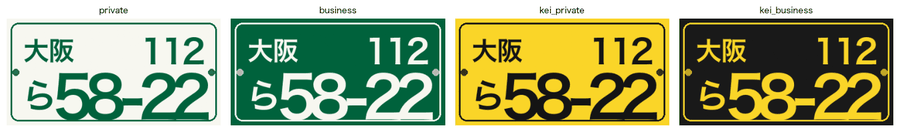

**生成した画像と、正解ラベルを重ねた図**（赤＝板を囲む枠、青の点＝四隅）

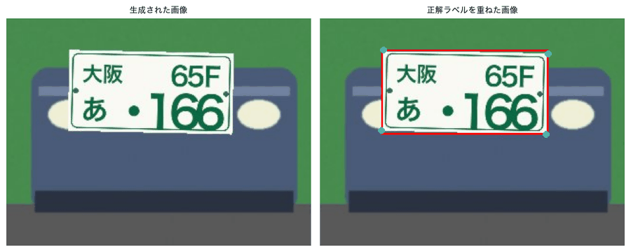

正解ラベルの中身（1枚ぶん）:

```
{ "text": "大阪 65F あ ・166", "region": "大阪", "class_no": "65F", "kana": "あ", "serial": "・166",
  "plate_type": "private", "bbox": [64.61, 33.27, 174.73, 89.29], "difficulty": "easy", "seed": 0 }
```

**背景は3種類**（壁・グラデーション・車体）

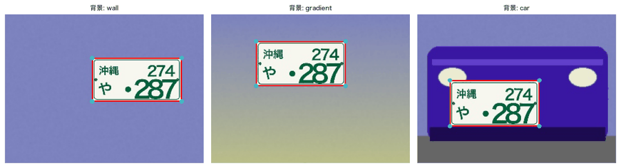

**劣化を1つずつ**（暗さ・低コントラスト・逆光・汚れ・雨滴・隠れ・ぼけ・ブレ・低解像度・ノイズ・JPEG・回転・透視）

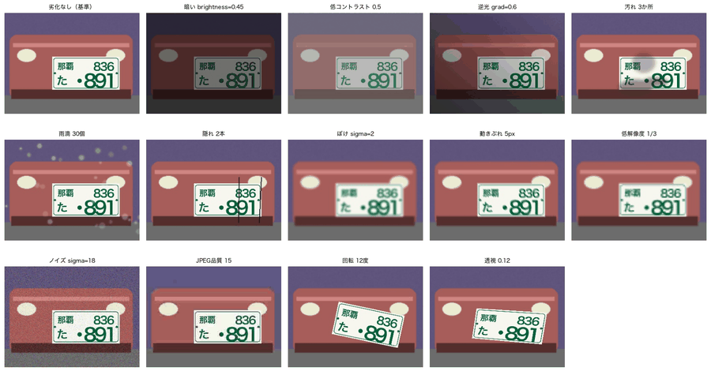

**難易度ごとのパラメータの範囲**

| 難易度 | 板の大きさ（画面幅比） | 回転(度) | ぼけσ | ノイズσ | 明るさ | JPEG品質 | 汚れ(確率,最小,最大) | 紛らわしい物の数 |
|---|---|---|---|---|---|---|---|---|
| easy | 0.4〜0.55 | −2〜2 | 0〜0.5 | 0〜3 | 0.9〜1.1 | 85〜95 | 0, 0, 0 | 0〜0 |
| medium | 0.3〜0.45 | −6〜6 | 0.3〜1.2 | 3〜8 | 0.7〜1.2 | 60〜85 | 0.3, 1, 2 | 0〜1 |
| hard | 0.2〜0.35 | −12〜12 | 0.8〜2.0 | 8〜18 | 0.4〜1.0 | 30〜60 | 0.7, 2, 4 | 1〜3 |

**同じ番号で、難易度だけを変えた画像**（上から Easy / Medium / Hard。赤＝枠、青＝四隅）

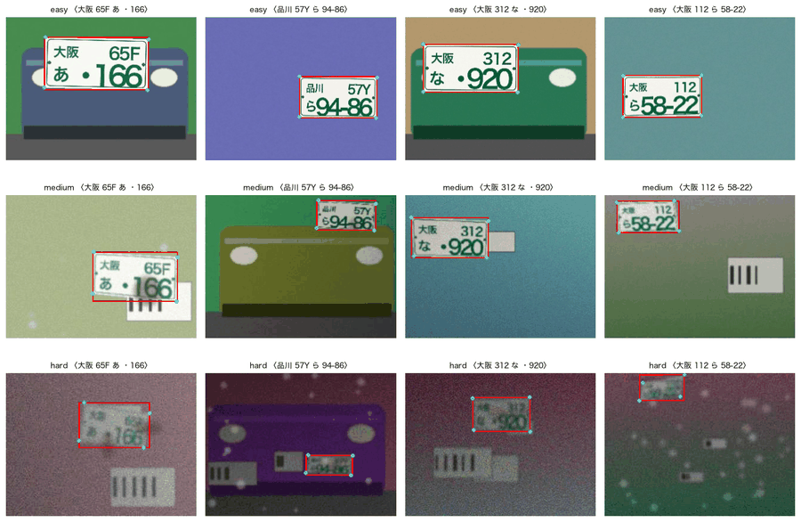

**再現性**: 同じシードで作り直すと、`画像が完全に同じ: True ／ ラベルが同じ: True`。

**評価用データの内訳**（固定シードで先に作る）

| セット | 難易度 | 枚数 | 板の幅の平均(px) | 地名の種類 |
|---|---|---|---|---|
| val | easy | 500 | 153.3 | 5 |
| val | medium | 500 | 124.5 | 5 |
| val | hard | 500 | 94.3 | 5 |
| test | easy | 1000 | 153.5 | 5 |
| test | medium | 1000 | 124.1 | 5 |
| test | hard | 1000 | 95.2 | 5 |

### 読み取れること
- **画像と正解が同時に作られる**ので、人手で正解を付ける作業が要らない。板の位置（枠・四隅）と文字が、最初から分かっている。
- **難易度が上がるほど**、板は小さく（幅の平均が153→124→94px）、傾き・ぼけ・ノイズ・汚れが強くなり、**紛らわしい白い板**も増える。Hardは、人間にも読みにくい。
- 劣化の種類で、影響が違う。**回転・透視は板の「形」**（検出に影響）、**ぼけ・ノイズ・低解像度は文字の「細部」**（OCRに影響）を変える。
- シードを固定すると、いつ実行しても同じ画像になる。**結果を比べるために必要**。
- **現実との差**（sim2realギャップ）がある。書体・背景・質感は実物と違うので、ここでの精度は実際の性能を保証しない。

### 演習
- `seed=0` を `seed=7`、`seed=100` に変えて、毎回違う板ができ、同じ数字なら同じ結果になることを確かめる
- `noise_sigma=18.0` を `40.0`、`60.0` に変えて、**人間にも読めなくなる限界**を探す（`blur_sigma` も）
- （上級）`spec.py` の `REGIONS` に `"名古屋"` を追加して、地名を増やす（カーネルを再起動）

---

## 01. 非AIのベースライン — [01_classical_baseline.ipynb](01_classical_baseline.ipynb)

**このNotebookのゴール**: AIを使わない**古典的な方法**（色・形のルールで板を見つけ、文字の見本と比べて読む）で、どこまで読めるかを測る。**AIの価値を測る基準**を作り、**なぜ古典的手法が壊れるか**を理解する。

**やること**
1. 板を見つける（色で白黒にする → 穴埋め → 連結成分 → 大きさ・形の条件）
2. 板をまっすぐに直し、文字を1文字ずつ見本と比べて読む
3. 難易度別に、**検出だけ／OCRだけ／全体**の3つの見方で測る
4. 失敗の原因を分析する

### 実行結果

**板を見つける手順**（元の画像 → 明るく色の薄い画素 → クロージング → 穴埋め・オープニング → 連結成分）

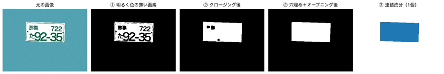

**検出結果**（緑＝正解の枠、赤＝検出した四隅）。この1枚は **IoU = 0.973** で検出成功。

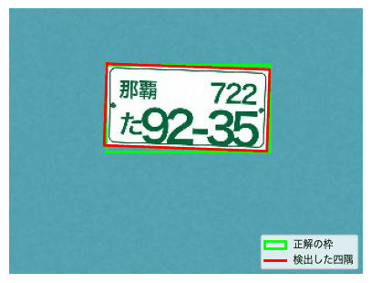

**板をまっすぐに直し、文字のセルに分ける**

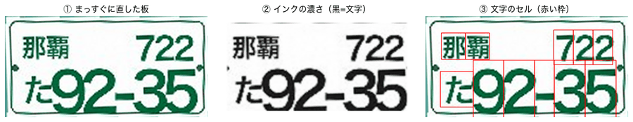

**1文字目の読み取り**（見本との類似度。赤＝最も似ている文字）

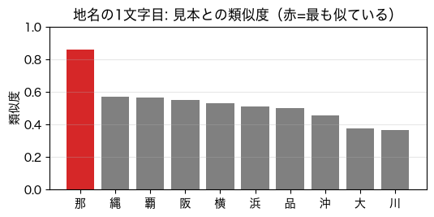

読み取りの例: `正解: 那覇 722 た 92-35 ／ 読み: 那覇 722 た 92-35 ← 完全一致: True`。板全体の確信度の目安（最小の類似度）は **0.67**。

**難易度別の結果**（各難易度60枚）

| 難易度 | 検出率 | OCRだけ（完全一致） | 全体（完全一致） | 全体（CER） |
|---|---|---|---|---|
| easy | 0.833 | 1.00 | 0.717 | 0.215 |
| medium | 0.883 | 0.65 | 0.183 | 0.409 |
| hard | 0.383 | 0.00 | 0.000 | 0.892 |

**全体の結果の内訳**（難易度別）

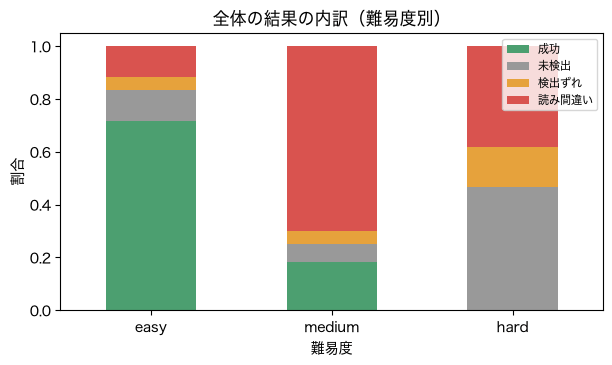

| 難易度 | 成功 | 未検出 | 検出ずれ | 読み間違い |
|---|---|---|---|---|
| easy | 0.717 | 0.117 | 0.05 | 0.117 |
| medium | 0.183 | 0.067 | 0.05 | 0.700 |
| hard | 0.000 | 0.467 | 0.15 | 0.383 |

**検出の位置ずれ（IoU）と、読み取りの成功率**

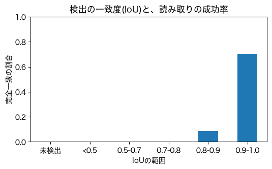

| IoUの範囲 | 枚数 | 読み取り成功率 |
|---|---|---|
| 未検出 | 39 | 0.000 |
| <0.5 | 15 | 0.000 |
| 0.5〜0.7 | 15 | 0.000 |
| 0.7〜0.8 | 14 | 0.000 |
| 0.8〜0.9 | 23 | 0.087 |
| 0.9〜1.0 | 74 | 0.703 |

**Hardの失敗例**（緑＝正解の枠、赤＝検出した枠）

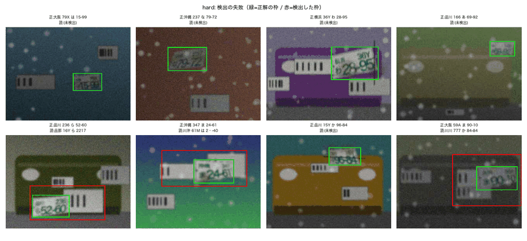

### 読み取れること
- **きれいな条件では、ほぼ完璧**: Easyで、正解の四隅を使う「OCRだけ」は完全一致1.00。仕組みが目で見え、学習データも要らず、速い。
- しかし**全体では、Easyでも0.72**。検出が「だいたい合っている」だけでは足りず、**検出で失敗した分（未検出0.117・検出ずれ0.05）と、位置のずれによる読み間違い（0.117）**が出る。
- **IoUが0.9以上でないと、読み取りはほとんど成功しない**（0.9〜1.0で0.703、0.8〜0.9で0.087、それ以下は0）。「IoU 0.5以上なら検出成功」という一般的な基準では、OCRにとっては足りない。**誤りは後ろの段階に伝わる**ので、システム全体で見ないと本当の性能は分からない。
- **難易度が上がると急に壊れる**。Mediumは読み間違いが0.70、Hardは未検出が0.47。人間が決めたしきい値（「明るさ7割」など）が、条件が変わると合わなくなるため。
- 古典的手法の弱点: ①しきい値が人間の決めた数字 ②似た別の物に弱い ③書式を手で書いている（**事業用の緑地の板は、そのままでは使えない**） ④劣化に弱い ⑤誤りが後ろに伝わる。
- この結果を、**AIがどれだけ良くするか**を、次のNotebook以降で測る。

### 演習
- `v_ratio = 0.7`（「明るい」の基準）を `0.9`、`0.5` に変える（3つの難易度の検出率の変化を見る。Easyで良くなる値が、Hardで悪化しないか）
- `noise_sigma = 10.0` を `20.0`、`40.0` に変える（読み取りの限界を探す。`blur_sigma` でも）
- 事業用（緑地に白文字）の板で試して、「白い板＋緑の文字」という前提がコードに書かれていることを確かめる（結果は検出率0.00）

---

## 02. 検出（四隅回帰）— [02_detection_cnn.ipynb](02_detection_cnn.ipynb)

**このNotebookのゴール**: AIに、**例から**板の位置（四隅）を学習させる。学習の様子、予測、**位置の誤差が読み取りに与える影響**、**学習範囲外での振る舞い**を見る。

**やること**
1. 正解の四隅を、8個の数にする
2. 小さなCNNの中身を見る（画像の縦横が半分ずつになる）
3. 学習用の画像を**その場で生成**して学習する（6エポック、約17秒）
4. 学習したAIの予測を見る
5. 四隅に誤差を足して、読み取りへの影響を測る
6. 板が無い画像で、AIがどう答えるかを見る

### 実行結果

**正解の四隅**（左上・右上・右下・左下を、0〜1の8個の数にする）

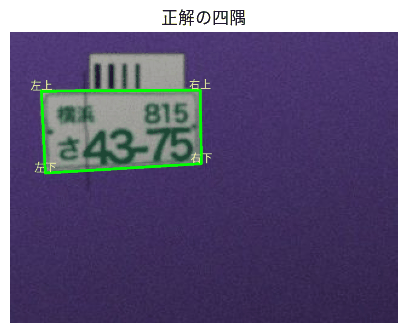

```
正解の8個の数: [0.08  0.2   0.489 0.197 0.492 0.45  0.09  0.482]
パラメータ数: 6,713,832
ブロック1〜5の出力: (32,120,160) → (64,60,80) → (128,30,40) → (128,15,20) → (256,8,10) → 全結合 → (8個の数)
```

**学習曲線**（6エポック。左: loss、右: valの平均IoU）

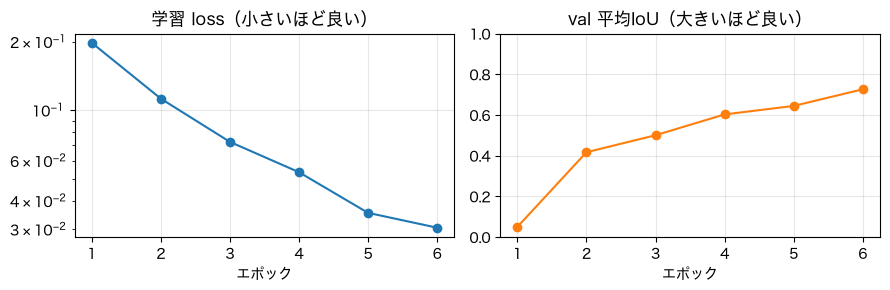

| エポック | loss | val平均IoU |
|---|---|---|
| 1 | 0.1979 | 0.049 |
| 2 | 0.1124 | 0.416 |
| 3 | 0.0726 | 0.500 |
| 4 | 0.0534 | 0.602 |
| 5 | 0.0354 | 0.644 |
| 6 | 0.0305 | 0.726 |

**学習したAIの予測**（緑＝正解、赤＝予測。上から Easy / Medium / Hard）

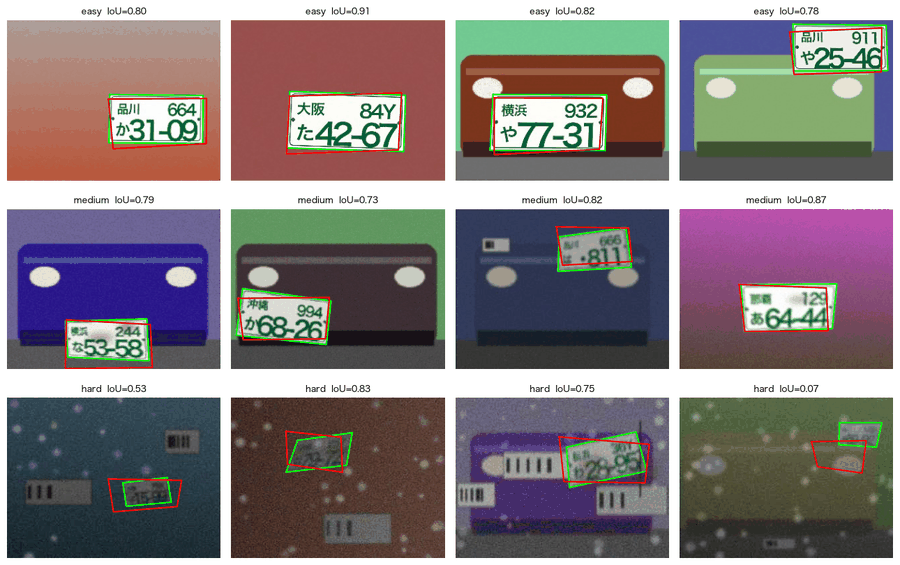

**四隅の誤差と、読み取りの成功率**（正解の四隅に、わざと誤差σを足す）

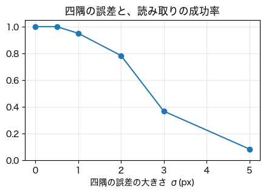

| 四隅の誤差 σ(px) | 読み取り完全一致 |
|---|---|
| 0 | 1.000 |
| 0.5 | 1.000 |
| 1.0 | 0.950 |
| 2.0 | 0.783 |
| 3.0 | 0.367 |
| 5.0 | 0.083 |

**板が無い画像でも、AIは「板の位置」を答えてしまう**（赤）

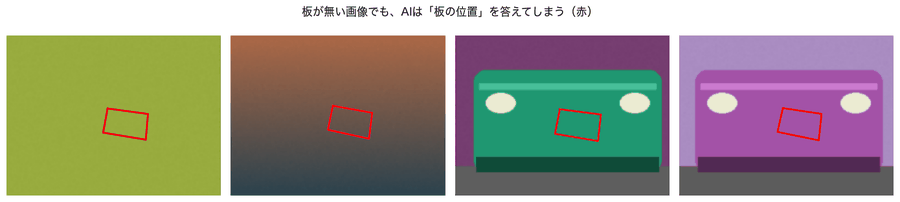

### 読み取れること
- **学習が進むとlossが下がり、IoUが上がる**（0.05→0.73）。最初は答えを出せず、数エポックで位置を当てられるようになる。
- 予測は、Easy・Mediumでは正解（緑）にほぼ重なる。Hardは**うまくいく例（IoU 0.83）と失敗例（IoU 0.07）**が混ざる。
- **位置の誤差が2〜3pxを超えると、読み取りが急に落ちる**（σ=2で0.78、σ=3で0.37、σ=5で0.08）。検出は**ピクセル単位の精度**が必要。01で見た「IoU 0.9以上が必要」と同じ理由。
- **板が無い画像でも、AIは必ず「板の位置」を答える**。AIは「無い」と答えることを学んでいないので、**「板があるかどうか」の判定は別に必要**。
- 6エポックの短い学習なので、このNotebookの検出器は**簡易版**。本格的なResNet18の検出器の結果は、[../REPORT.md](../REPORT.md)（検出率はEasy・Medium 1.000、Hard 0.998、ただし位置の精度が高い画像（Det@0.9）はHardで0.196）にある。

### 演習
- `EPOCHS = 6` を `2`、`12` に変えて、学習の長さの影響を見る
- `TRAIN_DIFFS = ("easy", "medium", "hard")` を `("easy",)` に変えて、**Easyだけで学習してHardで試す**（分布シフトを体験する）
- 誤差の範囲 `[0, 0.5, 1, 2, 3, 5]` を `[0, 1, 1.5, 2, 2.5, 3]` に変えて、許容範囲を細かく調べる

---

## 03. 文字認識（CRNN＋CTC）— [03_ocr_crnn.ipynb](03_ocr_crnn.ipynb)

**このNotebookのゴール**: AIに、板の文字を**例から読む**ことを学習させる。**CTC**の仕組み（文字の位置を教えなくても学習できる）、位置のずれへの強さ、間違い方、確信度、そして**ラベルを壊す拡張（左右反転）が使えない理由**を理解する。

**やること**
1. 板をモデルの入力の形にする（上段と下段を、横につなげた1行）
2. 学習済みモデルの出力（各位置の確率）を見る
3. 学習中に、読み取りが**立ち上がる**様子を見る（10エポック、約32秒）
4. 四隅の誤差への強さを、テンプレートOCRと比べる
5. 間違い方（取り違えやすい文字）を見る
6. 確信度と、自動処理の誤り率を見る

### 実行結果

**モデルへの入力**（板をまっすぐに直し、上段・下段を横につなげた1行 48×512）

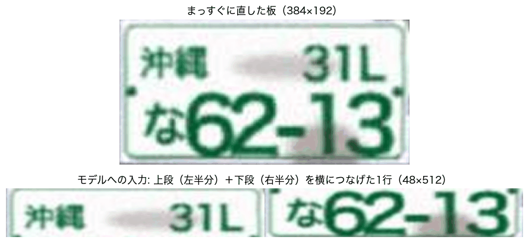

読み取りの例: `読み取り結果: 沖縄31Lな62-13 ／ 正解: 沖縄31Lな62-13 ／ 一致: True`

**学習が進むにつれて、読み取りが立ち上がる**（正解: 沖縄31Lな62-13。CTC lossは、最初19.15から下がる）

| エポック | CTC loss | 板の読み取り（最初の部分） |
|---|---|---|
| 1 | 19.153 | 「」（何も出ない） |
| 2 | 3.394 | 「」 |
| 3 | 3.033 | 「横浜」 |
| 4 | 2.821 | 「品川」 |
| 5 | 2.724 | 「沖浜」 |
| 6 | 2.680 | 「那縄」 |
| 7 | 2.634 | 「那覇」 |
| 8 | 2.591 | 「那覇」 |
| 9 | 2.571 | 「沖縄」 |
| 10 | 2.559 | 「沖縄」 |

**四隅の誤差に対する強さ**（Easy。テンプレートOCR＝01の方法、CRNN＝AI）

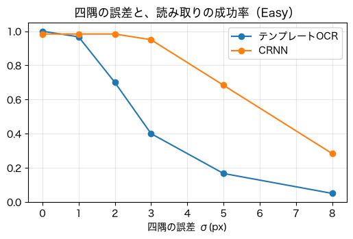

| 四隅の誤差 σ(px) | テンプレートOCR | CRNN |
|---|---|---|
| 0 | 1.000 | 0.983 |
| 1 | 0.967 | 0.983 |
| 2 | 0.700 | 0.983 |
| 3 | 0.400 | 0.950 |
| 5 | 0.167 | 0.683 |
| 8 | 0.050 | 0.283 |

**誤差の大きさごとの、直した板（1行）の見た目**

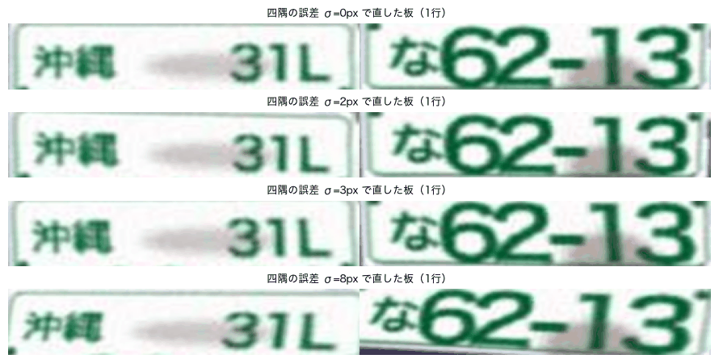

**Mediumの読み間違い**（検出器の四隅を使った標準モデル）

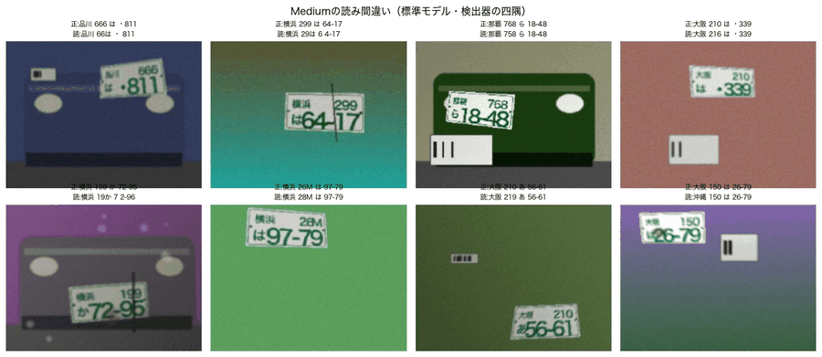

**よくある取り違え**（正解→読み）

| 難易度 | 文字数が違う読み取り | よくある取り違え |
|---|---|---|
| Medium | 3.0% | 6→5 ×10、は→な ×6、6→8 ×5、大→沖 ×5、阪→縄 ×5、か→た ×5 |
| Hard | **26.2%** | 7→1 ×51、6→8 ×49、6→5 ×46、9→5 ×44、1→7 ×39 |

**確信度（最小の文字確率）**

| 難易度 | 正解した画像の平均 | 誤った画像の平均 |
|---|---|---|
| easy | 0.821 | 0.600 |
| medium | 0.787 | 0.593 |
| hard | 0.592 | 0.283 |

| 確信度のしきい値 | 自動処理率（全体） | 自動処理した中の誤り率 |
|---|---|---|
| 0.50 | 0.688 | 0.0844 |
| 0.80 | 0.384 | 0.0224 |
| 0.90 | 0.241 | 0.0208 |
| 0.95 | 0.062 | 0.0224 |

**左右反転した板を読ませると**（左: 元の板 ／ 右: 左右反転）

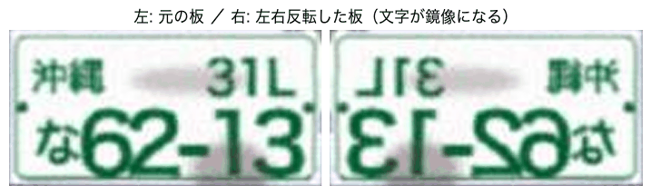

反転した板の読み取り: `大阪16ま・815-81`（正解は `沖縄31Lな62-13`）。

### 読み取れること
- **CTCは、文字の位置を教えなくても学習できる**。最初は何も出力せず（空）、数エポックで文字が出始め、地名の最初の2文字が正しくなる。lossが19→2.6へ下がる。
- **位置のずれに、テンプレートOCRより強い**。σ=2で、テンプレートOCRは0.70に落ちるが、CRNNは0.98を保つ。σ=3でも0.95。**AIは、位置のずれを含む例で学習した**ため。ただしσ=8では0.28に落ちる。
- **間違い方に偏りがある**。似た文字（6と5・8、7と1、は／な／ま、か／た）を取り違える。Hardでは**文字数が違う（脱落・余分）読み取りが26%**あり、細部が失われている。
- **確信度は、正解のときに高く、誤りのときに低い**傾向がある（Easy 0.82 対 0.60）。しかし**完全には分けられず**、しきい値を上げても、**自動処理した中の誤りは2%台**に残る。0.8以上では、しきい値を0.95まで上げても誤り率は約2%で**下げ止まる**（確信度の限界。自動処理率だけが0.38→0.06に減る）。
- **左右反転した板は、鏡文字になって読めず、でたらめな文字（「大阪16ま・815-81」）を答える**。反転は**ラベルを壊す**ので、データ拡張に使ってはいけない。
- この簡易学習は10エポックのみ。本格的に学習した標準モデルの結果は、次のNotebook以降と [../REPORT.md](../REPORT.md) にある。

### 演習
- `EPOCHS_Q = 10` を `20`、`30` に変えて、読み取りがどこまで立ち上がるか見る
- 誤差の範囲 `[0, 1, 2, 3, 5, 8]` を `[0, 2, 4, 6, 8, 12]` に変えて、CRNNの限界を調べる
- 左右反転した板を読ませて、なぜ拡張に使えないかを確かめる

---

## 04. ルール補正・確信度・「要確認」— [04_rules_confidence.ipynb](04_rules_confidence.ipynb)

**このNotebookのゴール**: **AIは間違える前提**で、システムを作る。書式検査・補正・確信度で、読み取りを「自動処理／要確認／読み取り不可」に振り分け、**しきい値を別の較正セットで決める**ことの大切さを理解する。

**やること**
1. 書式検査（ナンバーの形のルール）を試す
2. 書式が直せない画像を数える
3. 補正（書式に合う別の候補に差し替える）を見る
4. 確信度の分布を見る
5. しきい値を決めて、振り分ける
6. 誤課金の重さで、しきい値が変わることを見る

評価データは3,600枚（3シード分）、較正セットは9,000枚（3シード分）です。

### 実行結果

**書式検査**

| 文字列 | 書式 | 理由 |
|---|---|---|
| 沖縄300あ12-34 | ✔ 正しい | |
| 沖縄300あ・・12 | ✔ 正しい | |
| 沖縄3O0あ12-34 | ✘ 違反 | 分類番号「3O0」の形が違う |
| 沖縄300あ1234 | ✘ 違反 | 一連番号「1234」が「・」＋数字(4文字)の形でない |
| 東京300あ12-34 | ✘ 違反 | 地名「東京」が一覧にない |
| 沖縄300ん12-34 | ✘ 違反 | かな「ん」が一覧にない |
| 沖縄300あ12 | ✘ 違反 | 文字数が8（10か11が正しい） |

**書式が直せず「読み取り不可」にした画像**: 368枚（評価データ全体の **10.2%**）。**そのうち、AIの読み取りが実は正解だった画像は0枚**。難易度別: hard 316、medium 36、easy 16。

**補正の例**（正解 `横浜36Yわ28-95` を、AIは `横覇36Yわ28-95` と読み、書式違反になる → 次点の候補から `浜` に差し替え）

| 文字目 | 読んだ文字 | 確率 | 次点の候補 |
|---|---|---|---|
| 1 | 横 | 0.48 | 那(0.34), 品(0.09), 大(0.08) |
| 2 | **覇** | 0.46 | **浜(0.33)**, 阪(0.11), 川(0.09) |
| 3 | 3 | 0.99 | — |
| 5 | Y | 0.85 | F(0.08), H(0.02), L(0.01) |
| 8 | 8 | 0.85 | 6(0.06), 4(0.03), 5(0.03) |

補正が働いた画像: 38枚（評価データ全体の1.06%）。**補正後に正解になったのは1枚だけ**。完全一致は、補正前0.6517 → 補正後0.6519（ほぼ変わらない）。

**確信度（seq）の分布**（正解と誤りを比べる）

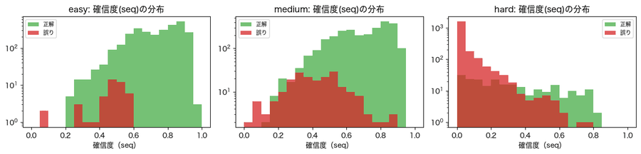

**カバレッジ曲線**（横軸＝自動処理にする割合、縦軸＝自動処理した中の誤り率。左: 難易度を均等に混ぜた場合、右: 昼間中心）

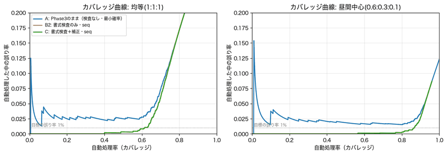

**誤課金の重さNで、しきい値と期待コストが変わる**（較正セットで決めたしきい値を、評価データに適用）

| 誤課金の重さ N | しきい値 | 自動処理率 | 自動処理の誤り率 | 要確認・読み取り不可率 | 1台あたりの期待コスト |
|---|---|---|---|---|---|
| 1 | 0.000 | 0.957 | 0.0974 | 0.043 | 0.137 |
| 5 | 0.384 | 0.856 | 0.0207 | 0.144 | 0.232 |
| 20 | 0.554 | 0.740 | 0.0064 | 0.260 | 0.355 |
| 100 | 0.686 | 0.515 | 0.0023 | 0.485 | 0.602 |
| 500 | 0.885 | 0.108 | 0.0000 | 0.892 | 0.892 |

**目標の誤り率1%で決めたしきい値（0.524）**の結果（昼間中心の混ぜ方）

| 項目 | 値 |
|---|---|
| 自動処理率 | 0.7728 |
| 自動処理の誤り率 | **0.0075** |
| 要確認率 | 0.1838 |
| 読み取り不可率 | 0.0433 |

自動処理のうち、誤りだった27枚（均等に混ぜた場合の評価データ3,600枚中、自動処理2,024枚の1.33%）の内訳は、medium 19・hard 7・easy 1。取り違えは `6→8 ×3`、`0→6 ×2`、`5→6 ×2`、`な→ら ×2` など、**似た文字の1字違い**。誤りの確信度の平均は0.64で、正解の平均0.75より低い。

### 読み取れること
- **書式検査は有効**。書式違反で「読み取り不可」にした画像は**100%誤り**だった（AIが実は正解だった画像は0枚）。ただし、書式に合っていても誤りは残る。
- **補正の効果は、ほぼゼロ**（完全一致0.6517→0.6519）。補正が働くのは全体の1%だけで、直せたのは1枚。AIの誤りの多くは、**書式に合う別の文字**への取り違えなので、書式では直せない。
- **確信度で、正解と誤りをある程度分けられる**が、重なりがある。Hardは確信度が低い画像が多く、人に回すのが妥当。
- **しきい値は、評価データとは別の「較正セット」（数千枚）で決める**。昼間中心の混ぜ方で、目標1%に対して**実現した誤り率は0.75%**（見積もりどおり）。均等な混ぜ方では1.33%になり、**想定と違う混ざり方だと、ずれる**。
- **誤課金の重さNで、最適なしきい値が変わる**。誤課金が軽い（N=1）なら、ほぼ全部を自動処理（誤り率9.7%）。重い（N=500）なら、ほぼ全部を人に回す（自動処理率10.8%）。**どの程度の誤りを許すかは、損害の大きさで決まる**。
- 自動処理の誤りは**「似た文字の1字違い」**が残る。これを止めるのが、次の**入庫記録との照合**。

### 演習
- `target = 0.01` を `0.005`、`0.02`、`0.05` に変えて、自動処理率と誤り率の関係を見る
- `for N in [1, 5, 20, 100, 500]:` を `[2, 10, 50, 1000, 5000]` に変えて、誤課金の重さの影響を見る
- 確信度の種類（`fin_seq`）を `fin_min_max`、`fin_margin` に変えて、3つの曲線を比べる

---

## 05. 入出庫シミュレーション — [05_parking_system.ipynb](05_parking_system.ipynb)

**このNotebookのゴール**: AIの読み取りを、**システム（入庫の記録・出庫の照合・料金計算）の一部品**として使い、**誤課金**と**人手の負担**を測る。**方針（要確認の出し方）によって、結果がどう変わるか**を理解する。

**やること**
1. 料金表を見る
2. データベース（SQLite）に入庫を記録する
3. 完全一致と、「近い」記録（1文字違い以内）で探す
4. 方針ごとに、3つのケースで挙動を比べる
5. 誤課金が起きたとき、何が起きるかを見る
6. 12,000台の出庫を、**シミュレーション**する

### 実行結果

**料金表**（30分無料・30分100円・1日上限1,500円）

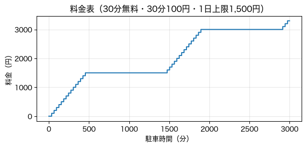

| 駐車時間(分) | 10 | 30 | 31 | 60 | 90 | 180 | 600 | 1440 | 1500 | 3000 |
|---|---|---|---|---|---|---|---|---|---|---|
| 料金(円) | 0 | 0 | 100 | 100 | 200 | 500 | 1500 | 1500 | 1600 | 3300 |

**入庫の記録**（3台。AとBは、4桁目の「3」と「8」だけ違う）

| id | plate | conf | entered_at | status | truth_vehicle |
|---|---|---|---|---|---|
| 1 | 沖縄300あ12-34 | 0.95 | 0.0 | in | 0 |
| 2 | 沖縄300あ12-84 | 0.93 | 5.0 | in | 1 |
| 3 | 品川500か77-21 | 0.97 | 8.0 | in | 2 |

`完全一致で A を探す: [1]` ／ `Aに近い記録（1文字違い以内）: [1, 2]`（Bも候補に入る）／ `Cに近い記録: [3]`

**方針ごとの、3つのケースの結果**（P1=保守・P2=照合を信頼・P3=保守＋近傍チェック・P4=照合を信頼＋近傍チェック）

| ケース | P1 | P2 | P3 | P4 |
|---|---|---|---|---|
| 1: 正しく読めた・自信あり | 自動精算 ✔正しい | 自動精算 ✔正しい | 要確認 | 要確認 |
| 2: **Bと読み間違え・自信満々** | 自動精算 **✘誤課金！** | 自動精算 **✘誤課金！** | 要確認 | 要確認 |
| 3: 正しく読めた・自信が低い | 要確認 | 自動精算 ✔正しい | 要確認 | 要確認 |

**誤課金が起きたとき**: Aの出庫をBと読み間違えて精算（誤課金）→ その後Bの車が出庫すると `読み取り不可・未照合`（Bの記録が先に閉じられていた）。**入庫中のまま残っている記録が1件**（Aの記録が閉じられずに残った）。

**シミュレーションの世界**（3,000台。左: 駐車時間、中: 同時駐車台数、右: 料金）

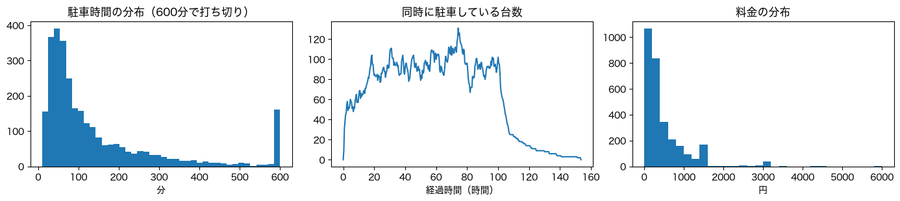

同時駐車は最大約131台。入庫順で近い車との間に、**1文字違いのナンバーの組が926組**ある。

**出庫12,000台のうち、人手に回ったのは1,914台（16.0%）**。理由の内訳:

| 理由 | 全出庫に対する割合 |
|---|---|
| 候補なし（未照合） | 0.0543 |
| 読み取り不可 | 0.0471 |
| 近い候補あり | 0.0291 |
| 確信度が低いため確認 | 0.0290 |

| 難易度 | 自動精算 | 要確認 | 読み取り不可・未照合 |
|---|---|---|---|
| easy | 0.970 | 0.017 | 0.013 |
| medium | 0.856 | 0.101 | 0.043 |
| hard | **0.023** | 0.175 | 0.802 |

**誤課金の重さNと、1台あたりの期待コスト**（ストレス条件S4。P1とP2が逆転する点がある）

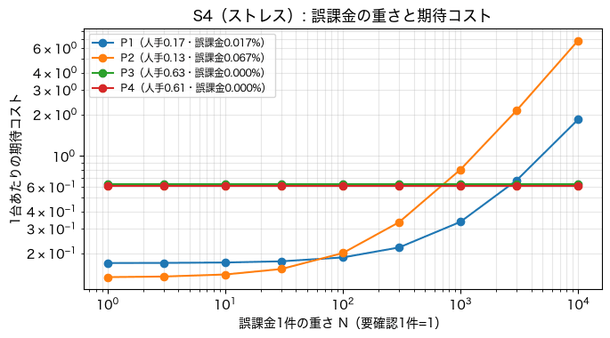

`P2がP1より得なのは、N が約 72 以下のとき ／ P3がP1より得になるのは、N が約 2748 以上のとき`

**人手の負担と誤課金のトレードオフ**（左）と、目標の誤り率ごとの期待コスト（右）

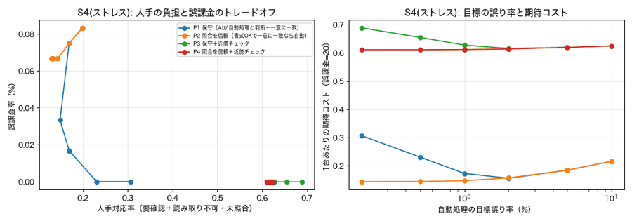

**目標の誤り率1%（S2）での、方針の比較**

| 方針 | しきい値 | 人手対応率 | 誤課金率 | 期待コスト(N=20) |
|---|---|---|---|---|
| P1 | 0.509 | 0.1595 | 0.00008 | 0.1612 |
| P2 | 0.509 | 0.1306 | 0.00017 | 0.1339 |
| P3 | 0.509 | 0.3775 | 0.00000 | 0.3775 |
| P4 | 0.509 | 0.3568 | 0.00000 | 0.3568 |

### 読み取れること
- **DB照合が、AIの「自信満々の誤り」の大半を止める**。12,000台のうち、誤課金は**数件以下**（P1: 誤課金率0.008%）。AI単独の誤り（自動処理で約0.6%）より、システム全体の誤課金は**ずっと少ない**。照合できない（記録が無い）ものは、人に回るため。
- **近傍チェック**（1文字違いの別の記録があれば要確認にする）は誤課金を**0**にするが、**人手が2〜3倍**（0.16→0.36〜0.38）になる。
- **どの方針が良いかは、誤課金の重さNで決まる**。Nが約72以下なら「照合を信頼」（P2）、約2,700以上なら「近傍チェック」（P3）が得。**方針は、損害の見積もりで選ぶ**。
- **人手の大半は、Hard**（自動精算は2.3%、人手は約98%）。撮影条件を改善する（暗さ・ぼけ・距離）ことが、最も人手を減らす。
- 誤課金が起きると、**後続の出庫にも影響する**（Bの記録が先に閉じられ、Bが未照合になる）。誤りは連鎖する。
- **ナンバーは車の所有者につながる情報**。実運用では、保存期間・利用目的を限定する必要がある（このNotebookは合成データのみ）。

### 演習
- `target = 0.01` を `0.002`、`0.05` に変えて、人手対応率と誤課金率の変化を見る
- `ExitPolicy(...)` の設定（`auto_if_valid`、`neighbor_check`、`near_k`）を変えて、**自分の方針**を設計し、S4（ストレス条件）で試す

---

## 06. 評価・検証レポート — [06_final_report.ipynb](06_final_report.ipynb)

**このNotebookのゴール**: プロジェクトを総括する。**最終評価（test）の結果**を読み、**どの条件でシステムが壊れるか**、**運用できる範囲の目安**、**誤りの傾向**を整理する。

**やること**
1. 最終評価の記録（`TEST_USED.json`）を読む
2. システムの道のり（P1→P2→P3）を見る
3. 混同行列（どの文字を取り違えるか）を見る
4. 劣化要因を1つずつ強くして、どこで壊れるかを見る
5. 「自信満々の誤り」を見る

### 実行結果

**最終評価の記録**（test。1回だけ使用）

```
実行日時: 2026-10-14T13:01:54
評価データ: test（難易度ごとに1,000枚）
しきい値: {'0': 0.509, '1': 0.421, '2': 0.553}   目標の誤り率: 0.01
注意: このファイルがある間、final_eval.py は test を評価しない。結果を見てモデルやしきい値を調整してはならない。
```

**システムの道のり**（左: 完全一致。P1=古典、P2=AI検出＋古典OCR、P3=AI検出＋CRNN ／ 右: 開発時(val)の見積もりと、最終(test)の一致）

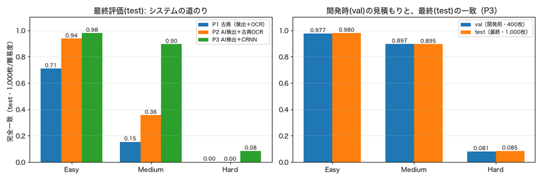

| 難易度 | P1 古典 | P2 AI検出＋古典OCR | **P3 AI検出＋CRNN** |
|---|---|---|---|
| Easy | 0.71 | 0.94 | **0.98** |
| Medium | 0.15 | 0.36 | **0.895** |
| Hard | 0.00 | 0.00 | **0.085** |

開発時（val）の見積もりと、最終（test）は**±0.01以内で一致**（P3: Easy 0.977→0.980、Medium 0.897→0.895、Hard 0.081→0.085）。

**数字・記号の混同行列**（左: Medium、右: Hard。縦＝正解、横＝読んだ文字。数字＝誤りの回数）

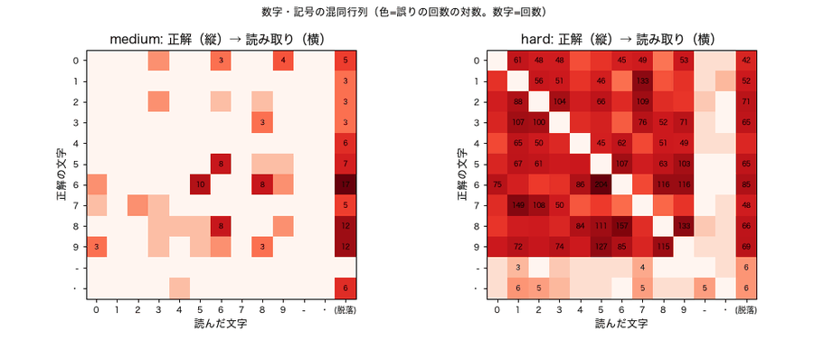

**かなの混同行列**

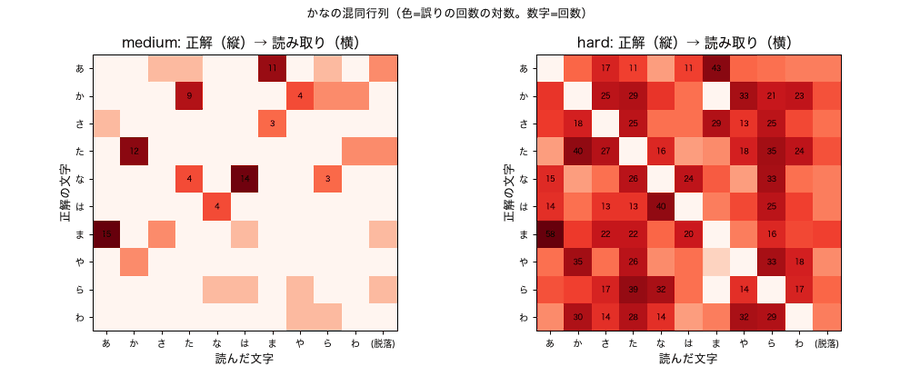

**劣化要因を1つずつ強くしたときの、読み取りの成功率**（青＝AI、橙＝古典。Easyの基準、板の大きさ40%）

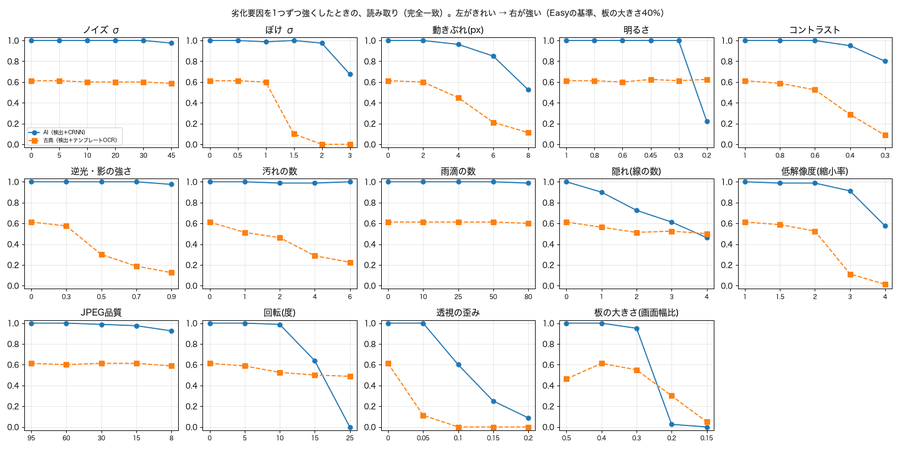

**「自信満々の誤り」**（自動処理と判断されたのに間違えた例）

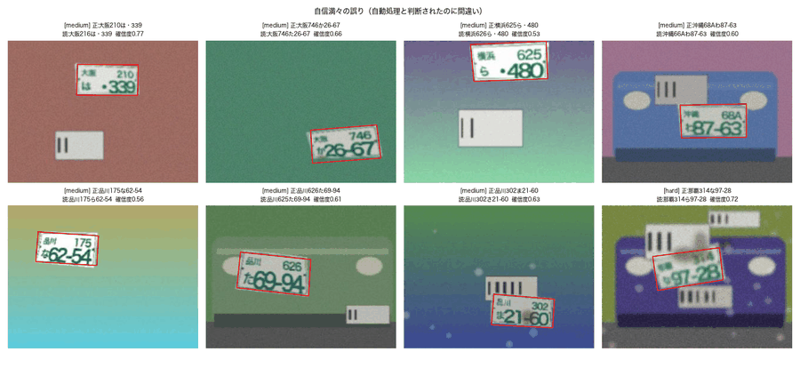

**3つの判定ごとの、読み取りの正解率**（test、シード0）

| 判定 | 枚数 | 正解 | 正解率 | 誤り |
|---|---|---|---|---|
| 自動処理 | 1,890 | 1,866 | **98.7%** | 24 |
| 要確認 | 805 | 124 | 15.4% | 681 |
| 読み取り不可 | 305 | 0 | 0.0% | 305 |

### 読み取れること
- **道のりで、AIが段階的に改善する**。Mediumは古典0.15 → AI検出＋古典OCR 0.36 → **AI検出＋CRNN 0.90**。検出だけAIにしても足りず、**文字認識もAIにして初めて大きく改善**する。
- **Hardは、AIでもほとんど読めない**（0.085）。画像から情報が失われているため。**読めないものを、人に回す設計が要る**。
- **開発時の見積もりが、未使用のtestで±0.01以内で再現**。しきい値や手法を、別のデータで決めて、testは1回だけ使うことの効果。
- **混同行列**: 数字では**6と5・8、7と1、9と5**、かなでは**は／な／ま、か／た**など、**似た形の文字を取り違える**。Hardでは、数字全体にわたって取り違えが散らばる（情報が失われているため）。
- **劣化要因ごとに、壊れ方が違う**。ノイズ・明るさ・JPEG品質には比較的強いが、**ぼけ・回転・透視・板の小ささ**では、AI（青の線）が**ある強さを超えると急に落ちる**。AIは**学習した範囲の端で急に崩れる**。古典（橙の破線）は、Easyの基準でも最初から低い。
- **自動処理の正解率は98.7%**。要確認の正解率は15.4%、読み取り不可は0%で、**人に回すべきものが、ほぼ正しく人に回っている**。
- **自信満々の誤り**（自動処理で間違い）は、Mediumの似た文字の取り違えが中心。**運用では、照合（05）で止める**。
- **testは使用済み**。再評価は拒否される（再評価が必要なら、新しいシードのtestセットを作る）。

### 演習
- 「運用できる範囲の目安」の表を見て、**自分のカメラの設置計画**を書く
- 判定の `"自動処理"` を `"要確認"` に変えて、各判定の正解率を比べる
- `final_eval.py --split test --confirm-final` を実行してみる（**実行しても安全**。使用済みなので拒否されるだけ）

---

## 07. 学習なしのAI（VLM）との比較 — [07_vlm_comparison.ipynb](07_vlm_comparison.ipynb)

**このNotebookのゴール**: 「**作る**（自作）か**借りる**（学習なしの大きなAI）か」を、同じ画像で比べる。**書式を教えると変わること**、**自己申告の自信**、**速度・コスト・プライバシー**の違いを理解する。

**やること**
1. 2種類の質問（**素の質問**／**書式つき**）を見る
2. 同じ画像に対する、各AIの答えを見る
3. 自作と、ローカルのVLM・Claudeの精度を比べる
4. VLMの「自己申告の自信」を見る
5. 自動処理のしきい値を変えて、比べる

比較の対象は、自作（検出ResNet18＋CRNN）、ローカルVLM（qwen3.8:27b）、Claude Sonnet、Claude Haiku です。評価には、**新しい未使用セット（test2）**の、各難易度60枚を使います。**外部に送ったのは合成画像のみ**です。

### 実行結果

**2種類の質問**

- **書式つき**: 「ナンバープレートは2段で…上段: 左に地名（2文字）・右に分類番号（3文字）、下段: 左にひらがな・右に一連番号（4桁）。地名は沖縄・那覇・品川・横浜・大阪のどれか…」と、**自作のシステムと同じ知識**を与える。
- **素の質問**: 「この画像の中の、ナンバープレートの文字を読み取ってください」だけ。何も教えない。

どちらも、`{"text": "沖縄 300 あ 12-34", "confidence": 0.0〜1.0}` のJSONで答えさせる。

**同じ画像への答え**（左から Easy / Medium / Hard。正解・ローカルVLM・Claude Sonnetの答えと自信）

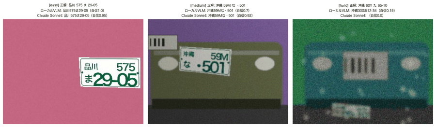

**自作 vs 学習なしのVLM**（書式つきの質問・test2・各難易度60枚。完全一致）

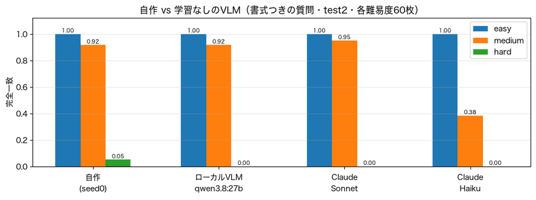

| システム | Easy | Medium | Hard |
|---|---|---|---|
| 自作（seed0） | 1.00 | 0.92 | 0.05 |
| ローカルVLM（qwen3.8:27b） | 1.00 | 0.92 | 0.00 |
| Claude Sonnet | 1.00 | **0.95** | 0.00 |
| Claude Haiku | 1.00 | 0.38 | 0.00 |

**VLMの自己申告の自信**（Claude Sonnet。緑＝正解、赤＝誤り）

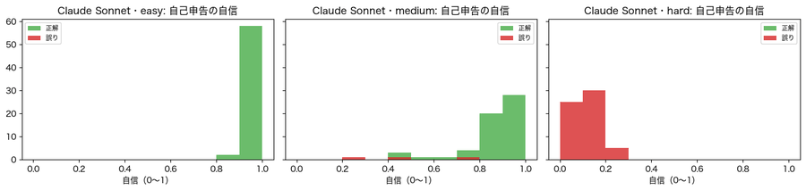

**自信が0.9以上のものだけ自動処理にしたとき**

| システム | 自動処理の割合 | その中の誤り率 | 自動処理した枚数 |
|---|---|---|---|
| ローカルVLM [書式つき] | 0.483 | **0.0000** | 87 |
| Claude Sonnet [書式つき] | 0.478 | **0.0000** | 86 |
| Claude Haiku [書式つき] | 0.433 | 0.0256 | 78 |

**Hardで、Claude Sonnetが答えたもの**（先頭8枚）

| 正解 | VLMの答え | 自己申告の自信 |
|---|---|---|
| 大阪812か93-85 | 品川330わ93-85 | 0.15 |
| 那覇59Aわ25-10 | 品川300あ25-10 | 0.10 |
| 沖縄60Yた65-10 | （答えなし） | 0.00 |
| 沖縄341や31-88 | 沖縄341わ31-89 | 0.25 |
| 品川62Yか68-21 | 品川500わ12-34 | 0.05 |
| 大阪204ま53-28 | 那覇30Aあ53-28 | 0.20 |
| 横浜251か39-99 | 品川381あ30-00 | 0.10 |
| 那覇48Yか16-76 | 品川500あ12-34 | 0.05 |

### 読み取れること
- **書式を教えれば、Easy・Mediumでは、学習なしのVLMが自作に並ぶ**（Medium: 自作0.92、ローカル0.92、Sonnet 0.95）。**学習なしで**ここまで読める。ただし、**小さいモデル（Haiku）は劣る**（Medium 0.38）。
- **Hardは、どのAIも読めない**（自作0.05、VLMは0）。画像から情報が失われているため。自作が**わずかに上**。
- **VLMは「分からない」と自己申告できる**。Hardでの自信は0.00〜0.25と低く、**自信が0.9以上のものだけを自動処理にすると、誤りは0%**（Haikuは2.6%）。**自分の限界を知っている**。
- Hardの答えは、**「書式に合う、もっともらしい別のナンバー」**（`品川500わ12-34` など、書式の例文に引きずられた答え）になることがある。**自信が低いので、要確認に回せる**。
- 比較は**精度だけでは決まらない**。自作は**速く**、**コストがほぼゼロ**で、**画像を外部に送らない**（プライバシー）。VLMは**学習が要らず**、**種別が変わっても対応しやすい**が、**1枚ごとに時間とコストがかかり**、**画像を外部に送る**（ローカルVLMなら送らない）。
- **併用**（自作の自信が低いものだけVLMに回す）で、自動処理率が上がる可能性がある（探索的な結果。詳細は [../REPORT.md](../REPORT.md)）。
- **外部に送る画像は、合成画像のみ**。実在のナンバーや車の写真は、送ってはいけない。

### 演習
- `my_prompt` を書き換えて、ローカルVLMに読ませる（**書式の一部だけ**教えると、結果はどう変わるか。画像は外に出ない）
- `th = 0.9` を `0.8`、`0.95`、`0.99` に変えて、自動処理の割合と誤り率の関係を見る
- Hardで、VLMが**何を答えているか**を見る

---

## まとめ — 8本を通して分かること

1. **AIはシステムの一部品**: AIが担うのは「検出」と「文字認識」だけ。補正・確信度・入出庫照合・人への引き継ぎで、**システム全体の誤課金を抑える**。
2. **まず非AIのベースラインを作る**: 古典的手法の弱点（人間が決めたしきい値・書式の手書き・誤りの連鎖）が分かり、**AIの価値を測れる**。
3. **誤りは後ろの段階に伝わる**: 検出の位置が数px（IoU 0.9未満）ずれるだけで、読み取りが失敗する。**システム全体で評価する**。
4. **AIは学習した範囲の端で急に崩れる**: 位置の誤差・ぼけ・回転・板の小ささ。**どこで壊れるか**を測っておく。Hardのように**情報が失われた画像は、読めない**ので、人に回す設計が要る。
5. **確信度としきい値**: 確信度は完全ではなく、しきい値は**別の較正セット**で決める。**どの程度の誤りを許すかは、損害の大きさ**で決まる。
6. **評価は、testを最後に1回だけ**: 開発時の見積もりが、未使用のtestで±0.01以内で再現した。
7. **作るか借りるか**: 学習なしのVLMは、書式を教えればEasy・Mediumで自作に並ぶ。**精度・速度・コスト・プライバシー**で選ぶ。
8. **合成データの限界**: 書体・背景・質感は実物と違う。**この精度は、実際の性能を保証しない**。実運用では、ナンバーが**所有者につながる情報**であることへの配慮（保存期間・利用目的の限定）が要る。
